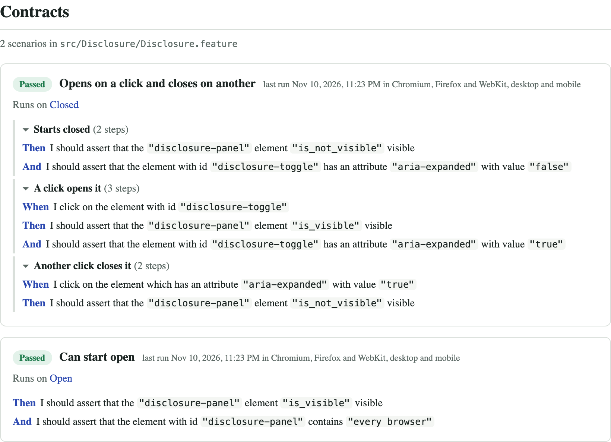

# Zucchini

**Cucumber's opinionated cousin.** Component contracts for Storybook, written in Gherkin with a library of
generic, precise steps, and shown in Storybook as a living spec.

Cucumber asks you to write scenarios in your business's language and glue code to make each sentence run.
Zucchini takes the opposite bet: a small set of **imperative steps keyed on test ids**, the same in every
project, so a contract needs no glue code at all, and anyone (product manager, developer or AI agent) can read
exactly what a component promises and check it in every browser.

```gherkin
# src/Disclosure/Disclosure.feature, beside Disclosure.stories.tsx
Feature: Disclosure

    @story:Closed
    Scenario: Opens on a click and closes on another
        # Starts closed
        Then I should assert that the "disclosure-panel" element "is_not_visible" visible

        # A click opens it
        When I click on the element with id "disclosure-toggle"
        Then I should assert that the "disclosure-panel" element "is_visible" visible
        And I should assert that the element with id "disclosure-toggle" has an attribute "aria-expanded" with value "true"
```

The component's Storybook docs page then shows its contracts, with each scenario's last result in Chromium,
Firefox and WebKit, on desktop and mobile:



## What you get

- **Contracts beside their stories.** `Badge.feature` sits next to `Badge.stories.tsx`. A scenario binds to a
  story with a `@story:` tag, or to several stories with a `story` column. `@desktop` and `@mobile` limit it to a
  device.
- **Ten generic steps**, checking text, exact values, tag names, attributes and visibility, and clicking,
  hovering and faking geolocation, all by test id. Add your project's own steps beside them.
- **A runner on Vitest browser mode** that renders each story through Storybook's Vitest add-on and runs its
  scenarios in Chromium, Firefox and WebKit, on desktop and mobile.
- **The living spec** in Storybook: every component's docs page shows its contracts and their last results, and
  an overview page lists every contract and the stories without one.
- **Guardrails for people and agents.** A generated step catalog (Markdown and JSON) lists every step with its
  meaning and an example. A linter rejects unknown or ambiguous steps and contracts bound to missing stories,
  and warns about discouraged ones.
- **A mutation check** _(experimental)_. List realistic bugs, and `zucchini mutation` proves your contracts
  catch them. A contract that passes whatever the component does tests nothing.

## Requirements

- Storybook 10 with `@storybook/addon-vitest` and `@storybook/addon-docs`, on Vite (6, 7 or 8)
- Vitest 5 with `@vitest/browser-playwright`, and Playwright
- React 18 or 19
- Node 22.12 or later

## Quick start

In a Storybook 10 project on Vite and React, such as one `npx storybook init` just set up.

**1. Install** Zucchini, with Vitest 5 and the Playwright pieces. (`storybook init` adds Vitest, but may pick
version 4.)

```sh
npm install --save-dev @camperoni/zucchini @storybook/addon-vitest vitest@^5 @vitest/browser-playwright@^5 playwright
npx playwright install chromium
```

**2. Configure** where your contracts and the step catalog live:

```ts
// zucchini.config.ts
import { defineConfig } from '@camperoni/zucchini'

export default defineConfig({ contracts: 'src', catalog: 'docs/zucchini' })
```

**3. Wire Storybook.** Add these to the config Storybook already has: the Vite plugin feeds the living spec,
the docs page shows it, and `runStoryContracts` runs the contracts during a contract run (and does nothing
otherwise).

```ts
// .storybook/main.ts
import { zucchiniPlugin } from '@camperoni/zucchini/vite'

const config: StorybookConfig = {
  // ...your stories, addons and framework, with '../src/**/*.mdx' among the stories
  viteFinal: (viteConfig) => ({ ...viteConfig, plugins: [...(viteConfig.plugins ?? []), zucchiniPlugin()] }),
}
```

```ts
// .storybook/preview.ts (or .tsx)
import { contractViewports, runStoryContracts } from '@camperoni/zucchini/runner/preview'
import { ContractsDocsPage } from '@camperoni/zucchini/storybook'
import { INITIAL_VIEWPORTS } from 'storybook/viewport'

const preview: Preview = {
  tags: ['autodocs'],
  afterEach: runStoryContracts,
  parameters: {
    // ...your parameters
    viewport: { options: { ...INITIAL_VIEWPORTS, ...contractViewports } },
    docs: { page: ContractsDocsPage },
  },
}
```

**4. Add the overview page:**

```mdx
{/* src/Contracts.mdx */}
import { Meta } from '@storybook/addon-docs/blocks'
import { ContractsOverview } from '@camperoni/zucchini/storybook'

<Meta title="Living Spec/Contracts" />

<ContractsOverview />
```

**5. Define the contract runs:** one Vitest browser project per browser and device, on top of your Vite config.

```ts
// vitest.zucchini.config.ts
import { zucchiniProjects } from '@camperoni/zucchini/runner'
import { defineConfig, mergeConfig } from 'vitest/config'

import viteConfig from './vite.config.ts'

export default mergeConfig(viteConfig, defineConfig({ test: { projects: await zucchiniProjects() } }))
```

**6. Write a contract** in a `.feature` file named after the component, beside its stories file. Give the
elements it checks a `data-testid`, and name the story with a tag (`_` for a space):

```gherkin
# Button.feature, beside Button.stories.ts
Feature: Button

    @story:Primary
    Scenario: Shows its label
        Then I should assert that the element with id "button" contains "Button"
```

**7. Run it:**

```sh
npx zucchini catalog                                     # write the step catalog the linter checks against
npx zucchini lint                                        # check the contracts against it and their stories
npx zucchini contracts --config vitest.zucchini.config.ts   # run them; Chromium by default, desktop and mobile
npx storybook dev                                        # and see the results on the docs pages
```

For CI, run `zucchini catalog --check` (fails when the committed catalog is out of date), `zucchini lint`, and
`zucchini contracts --browser chromium,firefox,webkit` before building Storybook.

## The steps

| Step                                                                                     | Does                                      |
| ---------------------------------------------------------------------------------------- | ----------------------------------------- |
| `Then I should assert that the element with id "…" contains "…"`                         | the element's text contains the value     |
| `Then I should assert that the element with id "…" has an exact value of "…"`            | the element's text is exactly the value   |
| `Then I should assert that the element with id "…" is of type "…"`                       | the element's tag name, e.g. `a`          |
| `Then I should assert that the element with id "…" has an attribute "…" with value "…"`  | an attribute's exact value                |
| `Then I should assert that the "…" element "is_visible" visible` (or `"is_not_visible"`) | visibility, waiting for it                |
| `When I click on the element with id "…"`                                                | clicks it once it's visible               |
| `When I click on the element which has an attribute "…" with value "…"`                  | clicks by attribute, e.g. `aria-label`    |
| `When I "hover" over the element with id "…"` (or `"click"`)                             | hovers or clicks, then lets the UI settle |
| `When I "allow" geolocation and set the location to "…", "…"` (or `"deny"`)              | answers the page's location requests      |
| `When I wait for "…" seconds`                                                            | a fixed pause: _discouraged_              |

Every step's meaning and an example are in the generated catalog: see the
[demo's catalog](examples/demo/docs/zucchini/steps.md). To add your own, see
[project steps](docs/reference.md#project-steps).

## Used in production

Zucchini was built inside [Camperoni](https://camperoni.com), a summer camp search, and runs its Storybook's
component contracts: 35 scenarios across 12 components, on Chromium, Firefox and WebKit, desktop and mobile.
They are taking over from an older Storybook end-to-end suite, and the mutation check catches all 46 of its
deliberate breaks.

## The demo

[`examples/demo`](examples/demo) is a small Storybook whose four components carry their contracts, use every
step, and come with deliberate breaks. CI runs it on all three browsers from the packed package, as you'd
install it, and publishes it with its results at
[camperoni-com.github.io/zucchini](https://camperoni-com.github.io/zucchini/). It's the quickest way to see a
complete setup.

## Learn more

- [Reference](docs/reference.md): the config, the contract format, the steps' rules, every command, the runner
  and the results file.
- [The mutation check](docs/mutation.md) _(experimental)_.
- [Contributing](CONTRIBUTING.md) and [releasing](RELEASING.md).

Zucchini runs its scenarios with [`@lotun/vitest-cucumber`](https://github.com/lotun-io/vitest-cucumber) by
[matus-sabo](https://github.com/matus-sabo), on top of [Cucumber](https://cucumber.io),
[Storybook](https://storybook.js.org) and [Vitest](https://vitest.dev).

## License

[MIT](LICENSE), © 2026 Camperoni Inc. Created and maintained by Vasilis Georgitzikis.
